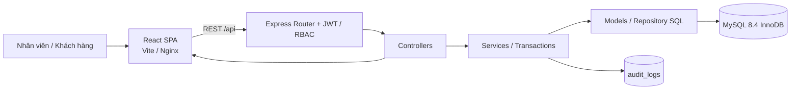
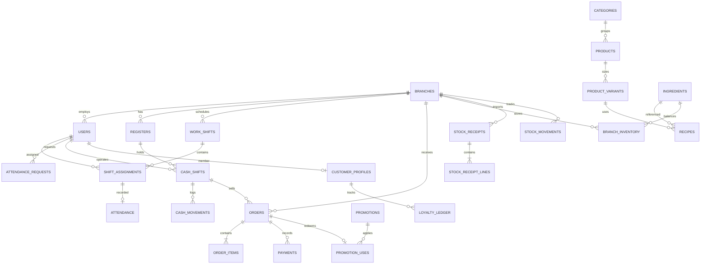
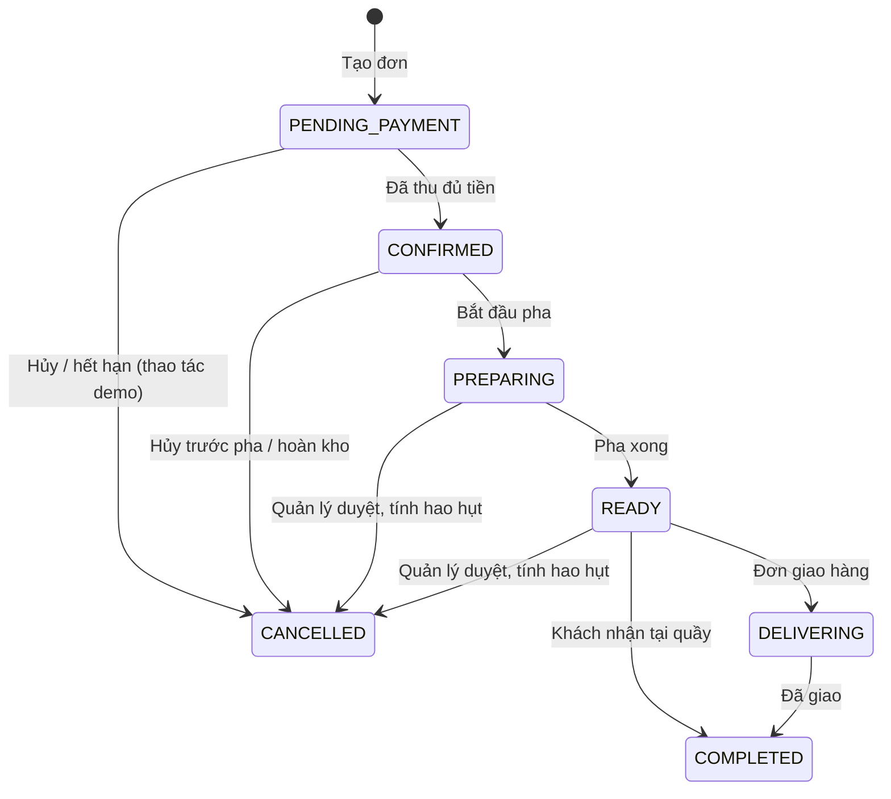

# Kiến trúc hệ thống BeanFlow (MVC)

## 1. Kiến trúc triển khai

MVC nằm tại **backend**, React là View/client riêng:

- **Model** (`apps/api/src/models`): truy vấn dữ liệu và xây các mô hình trả về. Một số truy vấn đặc thù về giao dịch đặt gần Service để thực hiện trong cùng transaction MySQL.
- **View** (`apps/web/src/pages`, `components`): React JSX, Tailwind CSS, quản lý state trên client; không truy vấn MySQL trực tiếp.
- **Controller** (`apps/api/src/controllers`): chuyển HTTP request thành các thao tác nghiệp vụ, validate quyền, trả JSON.
- **Routes** (`apps/api/src/routes`): định nghĩa endpoint và RBAC.
- **Service** (`apps/api/src/services`): nghiệp vụ cần nhiều bảng, tránh fat controller. Các luồng checkout, payment, inventory & promotion hoạt động bên trong MySQL transaction.

## 2. Sơ đồ thực thể (rút gọn)

## 3. Trạng thái đơn hàng

- Pha chế chỉ nhìn thấy đơn đã **thu đủ tiền**.
- Tại thời điểm xác nhận thanh toán đủ, hệ thống **khấu trừ tồn khả dụng** như một dạng giữ/ghi nhận sử dụng nguyên liệu tránh oversell. Nếu hủy trước khi pha thì cộng trả tồn (bản demo chưa phục hồi số lô gốc chính xác).
- Chuyển trạng thái chỉ theo hướng hợp lệ; đã giao/đã hủy không sửa đơn.
- `queue_number` cấp theo **ngày + chi nhánh**, sử dụng bảng `daily_sequences` và `LAST_INSERT_ID` trong transaction.

## 4. Phân quyền tổng quan

| Nhóm chức năng | Admin | Quản lý | Thu ngân | Pha chế | Khách |
|---|---|---|---|---|---|
| Toàn hệ thống / xem báo cáo | ✓ | Chi nhánh | Dashboard cơ bản | – | – |
| Phân ca/duyệt công | ✓ | ✓ | – | – | – |
| Chấm công cá nhân | ✓ | ✓ | ✓ | ✓ | – |
| Mở/bán/chốt ca | ✓ | ✓ | ✓ | – | – |
| Nhận và cập nhật pha chế | ✓ | ✓ | – | ✓ | – |
| Menu toàn chuỗi | ✓ | Đổi trạng thái/giá chi nhánh | Xem | Xem | Xem |
| Kho | ✓ | Chi nhánh | – | – | – |
| Khuyến mãi | ✓ | Xem | Xem | – | Áp voucher |
| Đặt món Web | ✓ | ✓ | ✓ | ✓ | ✓ |

API kiểm tra role, nhân viên không phải Admin bị ràng buộc bởi `branch_id` trên JWT identity tải lại từ MySQL.

## 5. Các thao tác nguyên tử

- **Đơn hàng:** xác định giá từ MySQL → tạo order/items → thanh toán → chặn vượt số tiền → kiểm kho bằng `FOR UPDATE` + `UPDATE quantity>=required` → khấu trừ kho → cấp số thứ tự → tăng lượt voucher → tích điểm → COMMIT.
- **Phiếu nhập:** kiểm trạng thái → khóa phiếu → cập nhật stock + weighted avg cost + lot + movement → khóa phiếu → COMMIT.
- **Chốt ca:** chặn đơn chưa hoàn tất → tính tiền dự kiến từ payments + cash movements → lưu counted/discrepancy → quản lý duyệt → khóa ca.

`withTransaction` được triển khai tại `apps/api/src/config/db.js` dưới tên `transaction`, lấy riêng MySQL connection từ pool. Không có transaction phân tán tới ngân hàng: tích hợp đó phải dùng webhook idempotent & outbox riêng.
